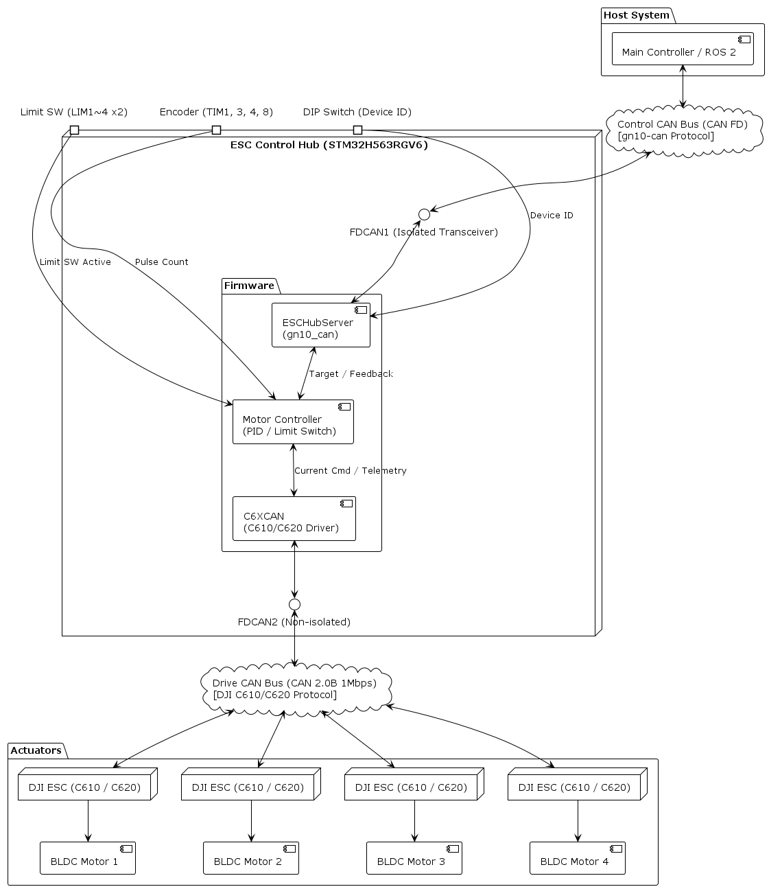
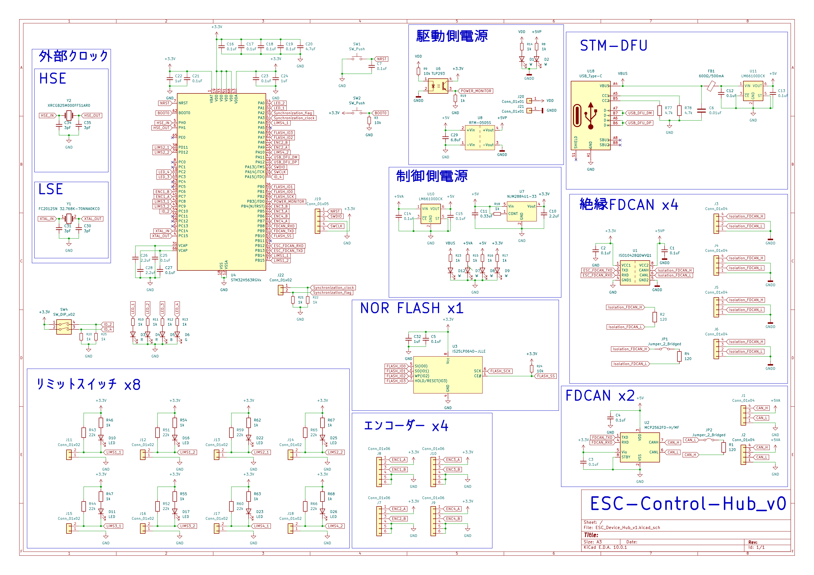
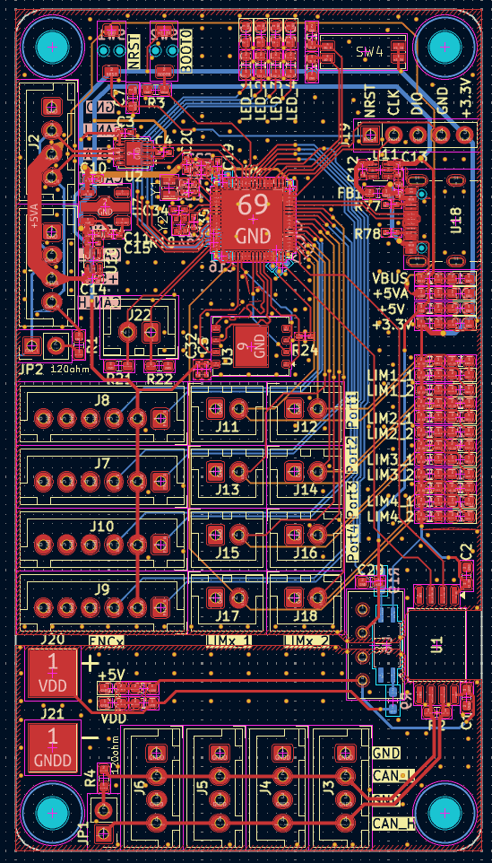
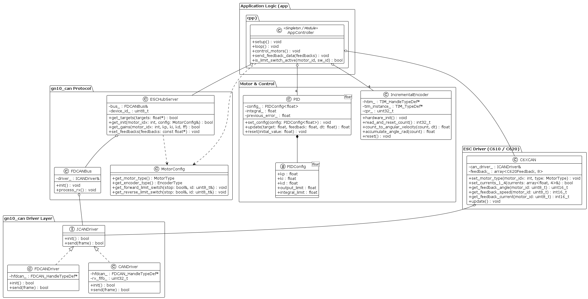
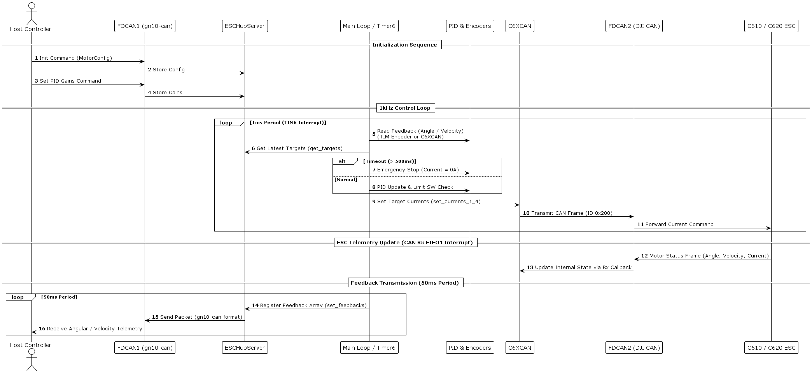

# ESC Control Hub

[English](README.md) | [日本語](README_jp.md)

Firmware and board design for controlling BLDC motors via isolated CAN communication with DJI C610/C620 ESCs upon receiving commands from `gn10-can`.  
For VESC-based launcher mechanism firmware, see [vesc-hub](https://github.com/tmcit-ararobo-2026a/vesc-hub).

## Table of Contents

1. [Overview](#1-overview)
2. [Documents](#2-documents)
3. [Contributing](#3-contributing)
4. [Build & Usage](#4-build--usage)
5. [System Architecture](#5-system-architecture)
6. [License](#6-license)

## 1. Overview

DJI C610/C620 ESCs use non-isolated CAN buses and a proprietary protocol, preventing direct connection to the robot central CAN bus.  
ESC Control Hub provides electrical bus isolation, protocol translation, 1 kHz PID feedback control, and limit switch protection.

## 2. Documents

| Document | Description |
| :-: | :-: |
| [CONTRIBUTING.md](./CONTRIBUTING.md) | Development workflow, branching rules, and commit conventions |
| [docs/requirements-definition.md](./docs/requirements-definition.md) | Hardware, communication, and I/O specifications |
| [docs/coding-rules.md](./docs/coding-rules.md) | Coding style and conventions |
| [docs/esc-control-hub-Sch.png](./docs/esc-control-hub-Sch.png) | Schematic diagram |
| [docs/esc-control-hub-PCB.png](./docs/esc-control-hub-PCB.png) | PCB layout |
| [docs/uml/](./docs/uml/) | PlantUML diagram source files |

## 3. Contributing

Refer to [CONTRIBUTING.md](./CONTRIBUTING.md) for full contribution guidelines.

- **Branch naming**: `feat/<issue-number>-<summary>` / `fix/<issue-number>-<summary>`
- **Commit message**: `feat`, `fix`, `refactor`, `docs`, `chore` (imperative/noun phrase, max 30 chars)
- **Merge condition**: At least 1 approving review and passing CI checks

## 4. Build & Usage

### 4.1 Prerequisites

- CMake 3.22+
- Ninja
- ARM GNU Toolchain (`arm-none-eabi-gcc` 10.3+)
- STM32CubeProgrammer (`STM32_Programmer_CLI`)

### 4.2 Build

```bash
# Debug build
cmake --preset Debug
cmake --build --preset Debug

# Release build
cmake --preset Release
cmake --build --preset Release
```

### 4.3 Flashing

Connect an ST-Link programmer and flash via VSCode or CLI:

- **VSCode**: `Tasks: Run Task` -> `Flash Firmware (ST-Link)`
- **CLI**:
  ```bash
  STM32_Programmer_CLI -c port=SWD -w build/Release/esc-control-hub.elf -v
  ```

### 4.4 Hardware Setup & Indicators

1. **Device ID**:
   Configure the 2-bit DIP switch to set the device ID (`0` to `3`).
2. **Wiring**:
   - `FDCAN1`: Main control CAN FD bus (`gn10-can` protocol, optically isolated)
   - `FDCAN2`: Drive CAN bus (DJI C610/C620 ESCs, non-isolated)
   - `LIM1~4`: Limit switches (up to 2 switches per motor channel)
   - `TIM1, 3, 4, 8`: External incremental encoders (optional)
3. **Status LEDs**:
   - `LED1 (Blue)`: Heartbeat (toggles every 500 ms)
   - `LED2 (Red)`: Target reception status (ON during valid reception; OFF on 500 ms timeout with motor output cut)
   - `LED3 (Green)`: ON upon receiving updated PID gains
   - `LED4 (Red)`: ON upon receiving motor configuration (`MotorConfig`)

## 5. System Architecture

### 5.1 Architecture Overview

Bridges the host controller and DJI ESCs to provide electrical isolation, protocol bridging, and closed-loop motor control at 1 kHz.


*(PlantUML source: [system_architecture.puml](./docs/uml/system_architecture.puml))*

### 5.2 Hardware Design

#### Schematic


#### PCB


### 5.3 Class Design

Illustrates dependency relations centered around the `AppController` module.


*(PlantUML source: [class_diagram.puml](./docs/uml/class_diagram.puml))*

### 5.4 Control Sequence

Executes a 1 kHz control loop triggered by TIM6 interrupt with fail-safe output shutdown on timeout.


*(PlantUML source: [sequence_diagram.puml](./docs/uml/sequence_diagram.puml))*

## 6. License

This repository is licensed under the [MIT License](./LICENSE).
