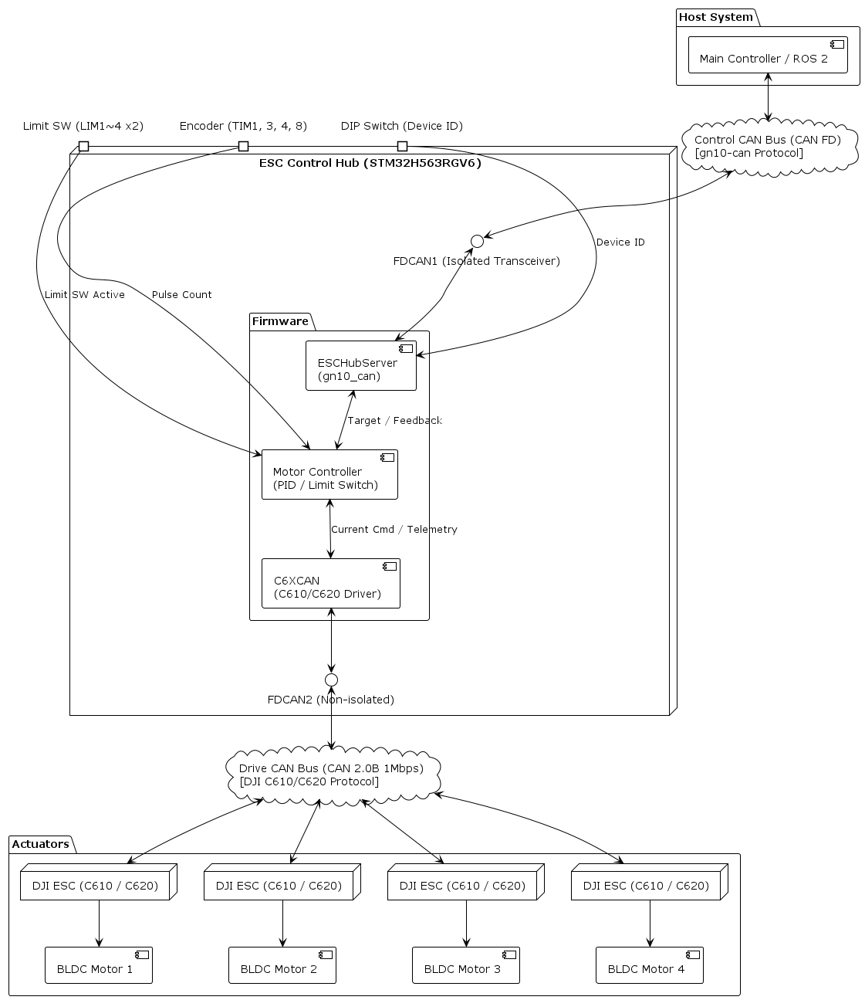
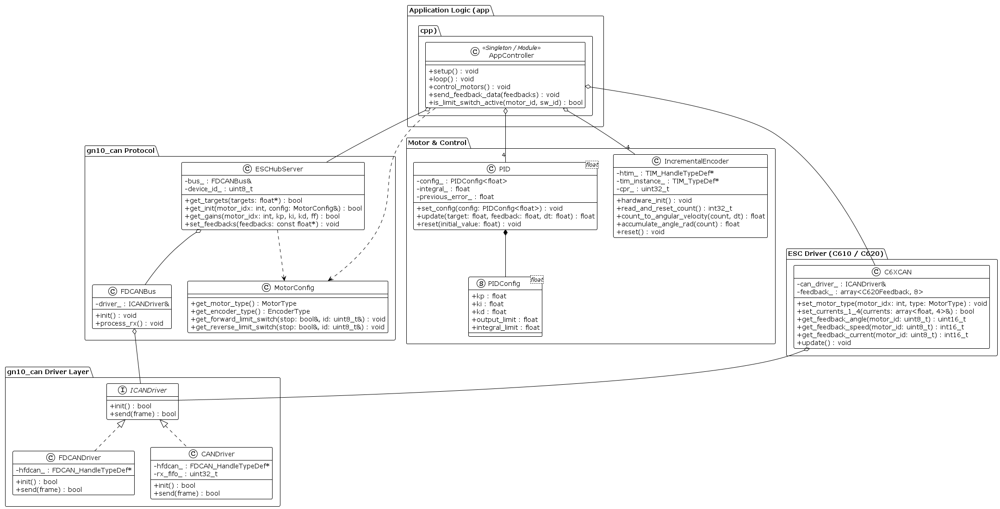
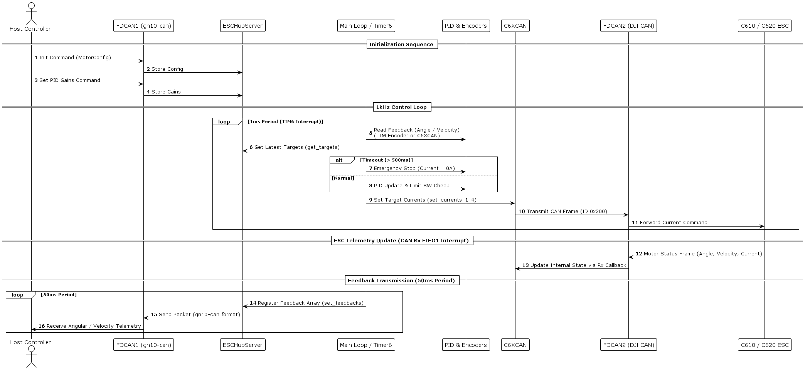

# ESC Control Hub

[English](README.md) | [日本語](README_jp.md)

gn10-canからの命令で絶縁したCANバスを用いてC620/C610と通信しBLDCを制御する基板とそのファームウェア
VESCによる投擲機構制御に対応したファームウェアは[vesc-hub](https://github.com/tmcit-ararobo-2026a/vesc-hub)にあります。

## 目次

1. [概要](#1-概要)
2. [ドキュメント](#2-ドキュメント)
3. [コントリビューション](#3-コントリビューション)
4. [ビルド・使い方](#4-ビルド使い方)
5. [システム構成](#5-システム構成)
6. [ライセンス](#6-ライセンス)

## 1. 概要

C610/C620などのESCのCANバスは駆動系統と絶縁されておらず、プロトコルもgn10-canではないため、ロボット中枢のCANバスに接続できない。
このESC Control Hubを用いることでCANバスを電気的に絶縁し、プロトコル変換・PID制御・リミットスイッチ制御が可能となる。

## 2. ドキュメント

| ドキュメント | 説明 |
| :-: | :-: |
| [CONTRIBUTING.md](./CONTRIBUTING.md) | 開発フロー・コミット規約・コーディング規約 |
| [docs/requirements-definition.md](./docs/requirements-definition.md) | 要件定義書（ハードウェア・通信・I/O仕様） |
| [docs/coding-rules.md](./docs/coding-rules.md) | コーディング規約 |
| [docs/uml/](./docs/uml/) | PlantUML ソースファイル |

## 3. コントリビューション

開発フロー、コミット規約、PR作成規則は [CONTRIBUTING.md](./CONTRIBUTING.md) を参照。

- **ブランチ命名**: `feat/<issue番号>-<概要>` / `fix/<issue番号>-<概要>`
- **コミットメッセージ**: `feat`, `fix`, `refactor`, `docs`, `chore`（体言止め）
- **マージ基準**: レビュー1名以上の承認およびCI通過

## 4. ビルド・使い方

### 4.1 必要環境

- CMake 3.22 以上
- Ninja
- ARM GNU Toolchain (`arm-none-eabi-gcc` 10.3 以上)
- STM32CubeProgrammer (`STM32_Programmer_CLI`)

### 4.2 ビルド手順

```bash
# Debug ビルド
cmake --preset Debug
cmake --build --preset Debug

# Release ビルド
cmake --preset Release
cmake --build --preset Release
```

### 4.3 書き込み

ST-Link を接続し、以下のいずれかで書き込む。

- **VSCode**: `Tasks: Run Task` -> `Flash Firmware (ST-Link)` を実行
- **CLI**:
  ```bash
  STM32_Programmer_CLI -c port=SWD -w build/Release/esc-control-hub.elf -v
  ```

### 4.4 ハードウェア設定・動作仕様

1. **デバイスID設定**:
   基板上の DIP スイッチ（2bit）で ID (0〜3) を指定。
2. **コネクタ接続**:
   - `FDCAN1`: 制御系 CAN FD バス（gn10-can プロトコル、絶縁）
   - `FDCAN2`: 駆動系 CAN バス（C610/C620 ESC、非絶縁）
   - `LIM1〜4`: リミットスイッチ（各ポート最大2系統）
   - `TIM1, 3, 4, 8`: 外部インクリメンタルエンコーダ（必要時）
3. **LED インジケータ表示**:
   - `LED1 (青)`: ハートビート（500ms 周期でトグル）
   - `LED2 (赤)`: 通信状態（指令受信時点灯、500ms タイムアウト時消灯・全モータ停止）
   - `LED3 (緑)`: PID ゲイン受信時点灯
   - `LED4 (赤)`: モータ初期設定（MotorConfig）受信時点灯

## 5. システム構成

### 5.1 全体構成

上位コントローラと DJI ESC（C610/C620）の間に配置し、CAN バスの電気的絶縁、プロトコル変換、1kHz のフィードバック制御を実行する。


*(PlantUML ソース: [system_architecture.puml](./docs/uml/system_architecture.puml))*

### 5.2 クラス設計

`app.cpp` を中心とした主要モジュールの依存関係を示す。


*(PlantUML ソース: [class_diagram.puml](./docs/uml/class_diagram.puml))*

### 5.3 制御シーケンス

TIM6 の 1kHz 割り込みで制御ループを実行。指令途絶時はフェールセーフとして出力を遮断する。


*(PlantUML ソース: [sequence_diagram.puml](./docs/uml/sequence_diagram.puml))*

## 6. ライセンス

本リポジトリは [MITライセンス](./LICENSE) のもとで公開されている。
